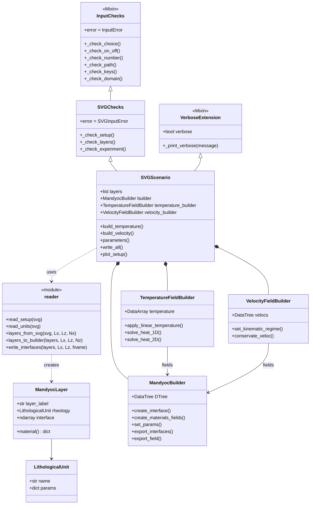
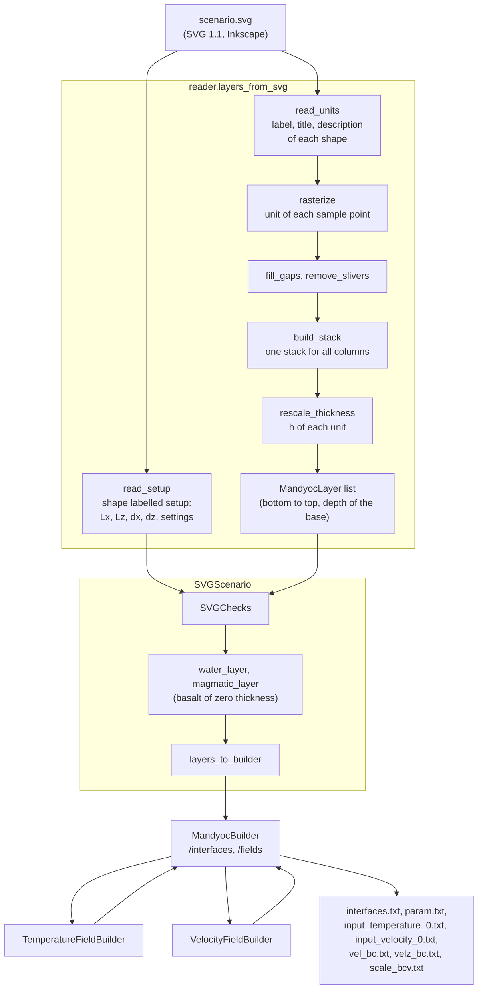
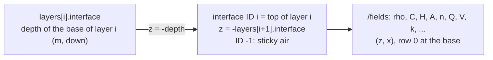

# SVG Scenarios Architecture

`tapioca.inputs.svg` turns a scenario drawn in an SVG file (SVG 1.1, saved by Inkscape) into the input files of
Mandyoc. It reads the drawing and the settings, and leaves the physics to the generic builders of
`tapioca.inputs`: the SVG code builds the stack of layers, and `MandyocBuilder`, `TemperatureFieldBuilder` and
`VelocityFieldBuilder` build the fields and export the files.

## 1. Class Architecture

`SVGScenario` extends the mixins of the generic inputs (`SVGChecks` for the checks of the parameters,
`VerboseExtension` for the prints) and composes the generic builders. The reader is a module of functions that
returns the stack of layers (`MandyocLayer`), whose materials come from `LithologicalUnit`.

### Class Responsibilities

*   **`SVGChecks` (extends `InputChecks`, `inputs/checks.py`):** checks the settings and the drawing (setup shape,
    stack of layers, combinations of settings) and raises `SVGInputError` with a message that names the parameter.
*   **`SVGScenario` (`inputs/svg/scenario.py`):** reads the settings (argument > SVG > default), chooses the water and
    magmatic layers, and drives the generic builders: the temperature (`solve_heat_2D` by default, or `solve_heat_1D`),
    the velocity of the kinematic regime (`set_kinematic_regime`) and the files (`write_all`).
*   **`reader` (`inputs/svg/reader.py`):** turns the shapes into a single stack of layers, bottom to top, with the
    depth of the base of each layer in every column, and converts it into the interfaces of a `MandyocBuilder`.
*   **`MandyocLayer` / `LithologicalUnit` (`inputs/svg/materials.py`):** a layer of the stack and its material (the 13
    parameters of `DEFAULT_MATERIAL`, from `DEFAULT_MATERIALS` and the description of the shape).
*   **`MandyocBuilder`, `TemperatureFieldBuilder`, `VelocityFieldBuilder` (`inputs/generic_input_classes.py`):** the
    generic builders, which own the `DataTree` with the interfaces and the fields and export the input files.

---

## 2. From the Drawing to the Input Files

### Steps

*   **Shapes to sample points:** `read_units` reads the object properties of each shape (Inkscape: *Object > Object
    Properties*): the first line of the description is the rheology, the next lines are `key = value` (`C`, `rho`
    and `H` are required; `h` is the reference thickness). `rasterize` maps the bounding box of the setup shape to the
    domain and samples the drawing (`Nx` columns, rows of 100 m), painting the shapes in document order as Inkscape
    does; it also keeps the unit painted over (`under`), the host of seeds and basins. `fill_gaps` fills the points
    not covered by any shape and `remove_slivers` removes thin layers left by shapes that overlap a little.
*   **Columns to one stack:** each interface of Mandyoc is a single line `z(x)`, so one stack must fit every column.
    `build_stack` joins the sequences of units of the columns with the shortest common supersequence (`scs`), e.g.
    `[asthenosphere, mantle, crust, air]` and `[asthenosphere, mantle, crust, seed, crust, air]` give the second one,
    with zero thickness for the seed and the upper crust slot where they are absent. Away from a body, its
    interfaces stay flat, so Mandyoc draws a box and not a funnel.
*   **Thickness `h`:** `rescale_thickness` makes the drawing independent of the vertical scale: a unit with `h` is
    stretched by `h / (its most common drawn thickness)`, bodies without `h` follow their host, and bodies with `h`
    get that thickness while their host absorbs the difference. The bottom unit fills the rest of the domain.
*   **Stack to builders:** `layers_to_builder` creates the interfaces of `MandyocBuilder` (see below) and
    `create_materials_fields` fills the material fields; the temperature and velocity builders add their fields.

---

## 3. Conventions

The reader works with depths positive downwards, as the SVG; the generic builders use the convention of Mandyoc:
z positive upwards, from `-Lz` at the base to `0` at the top, and node `(0, 0)` at the bottom-left corner.

*   **Interfaces:** ID `i` is the top of layer `i` and carries its material; ID `-1` is the sticky air.
*   **Surface and LAB:** the surface is the top of the solid layers (the base of the sticky air, or of the water
    when `water_layer` is given); the LAB is the top of the asthenosphere. Both are passed by ID to
    `TemperatureFieldBuilder` and to `set_kinematic_regime`.
*   **Water and magmatic layers:** chosen by the user (label or ID), never guessed from their position.
